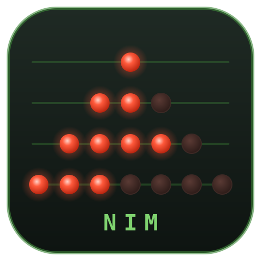

<p align="center">
  
</p>

<h1 align="center">NIM</h1>

<p align="center">
  A physical game of <a href="https://en.wikipedia.org/wiki/Nim">Nim</a>
  built from buttons and LEDs on an ESP32, simulated in Wokwi before it's built.
</p>

---

## The game

Sixteen lights are arranged in four heaps of 1, 3, 5 and 7:

```
Heap 1:                   ●
Heap 2:               ●   ●   ●
Heap 3:           ●   ●   ●   ●   ●
Heap 4:     ●   ●   ●   ●   ●   ●   ●
```

Each light has a button. On your turn, press one button: that light and every
lit light to its right in the same heap go out. Players alternate, and **whoever
takes the last light loses**. A slide switch chooses between two-player mode and
playing against an AI that plays optimal Nim strategy.

## Repository layout

| Path | What it is |
|---|---|
| [`Michaels_stuff/matrix-4x4/`](Michaels_stuff/matrix-4x4) | **The main game.** ESP32-S3 with the 16 buttons read as a 4×4 matrix (8 GPIOs), 16 directly driven LEDs, turn and winner LEDs, and a two-player/AI mode switch. Includes the exact pinout in [`wiring.md`](Michaels_stuff/matrix-4x4/wiring.md). |
| [`Michaels_stuff/matrix-serial-test/`](Michaels_stuff/matrix-serial-test) | Bring-up tool for the 4×4 button matrix on real hardware. No LEDs; it prints every press and release, with row and column GPIOs and a live grid, over serial. |
| [`tests/port-expander/`](tests/port-expander) | Earlier version of the full game on a classic ESP32: buttons and LEDs on four MCP23017 I/O expanders over I²C, simulated with a custom Wokwi chip. Includes a Fusion 360 script that generates the enclosure ([`cad/`](tests/port-expander/cad)). |
| [`tests/button-matrix/`](tests/button-matrix) | Proof of concept: a 2×2 button matrix on a classic ESP32, each button toggling its own LED. |
| [`tests/encoder-test/`](tests/encoder-test) | Experiment: reading two buttons on one analog pin through a resistor ladder, with a custom Wokwi chip because Wokwi can't simulate resistor dividers. |
| [`tests/button-test/`](tests/button-test) | The simplest starting point: one button toggles one LED. |

Each folder is a standalone PlatformIO project with its own `README.md`,
`diagram.json` (the Wokwi circuit) and `wokwi.toml`.

## Hardware

| Project | Board | Inputs | Outputs |
|---|---|---|---|
| `matrix-4x4` | ESP32-S3-DevKitC-1 | 4×4 matrix: rows GPIO 1, 2, 4, 5 and columns GPIO 6–9; mode switch on GPIO 40 | 16 game LEDs, 2 turn LEDs, 2 winner LEDs |
| `port-expander` | ESP32 DevKit v1 | 16 buttons + START through MCP23017 at `0x20`/`0x21` | 16 LEDs + 2 turn LEDs through MCP23017 at `0x22`/`0x23` |

## Getting started

You need [PlatformIO](https://platformio.org/) and the
[Wokwi](https://docs.wokwi.com/vscode/getting-started) extension for VS Code or
Cursor.

**Simulate**

1. Open a project folder, e.g. `Michaels_stuff/matrix-4x4`.
2. Build it: `pio run` or **PlatformIO: Build**.
3. Start the simulator: **Wokwi: Start Simulator**. Click the buttons to play.

**Flash a real board**

Plug the ESP32-S3-DevKitC-1 in through the port labelled **COM**/**UART**, then:

```sh
cd Michaels_stuff/matrix-serial-test   # test the button matrix first
pio run -e uart -t upload -t monitor
```

Once every button reports correctly, flash the game from
`Michaels_stuff/matrix-4x4` the same way (`pio run -t upload -t monitor`).

## Gotchas learned the hard way

- **Don't enable `ARDUINO_USB_CDC_ON_BOOT` for Wokwi.** On the ESP32-S3 it makes
  the firmware hang before `setup()` does anything, so no LEDs light and no
  buttons are read. Use UART0 serial instead.
- **Use the DevKitC-1's pin names in `diagram.json`.** GPIO 43/44 are `esp:TX`
  and `esp:RX`, 3.3 V is `esp:3V3.1`, and GPIO 33/34 aren't on the headers. An
  unknown pin name quietly leaves that wire unconnected.
- **Some pins behaved differently in Wokwi for VS Code than on wokwi.com.**
  GPIO 3, 37, 45 and 47 left LEDs dark in VS Code, so the game uses GPIO 19,
  20, 46 and 48 for those lights instead.
- **Add a diode per button** in the physical matrix if you want more than one
  button to be held at once without ghost presses. See
  [`wiring.md`](Michaels_stuff/matrix-4x4/wiring.md).
